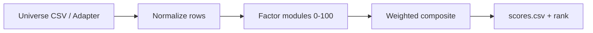

# ETF Fundamental Composite Scoring (Research)

**Purpose:** Transparent, reproducible **screening** of a research ETF universe.  
**Non-goals:** Live alpha claims, production trading signals, or “实盘升格”. Outputs are ranks for human review.

## Pipeline



1. Load universe via `FixtureCsvAdapter` (or future `ETFDataAdapter` implementations).
2. Each factor maps raw fields → **score ∈ [0, 100]** (higher = more attractive on that dimension).
3. Composite = Σ (weightᵢ × scoreᵢ), with **reweight** when a factor is missing (see failure modes).
4. Cross-sectional rank on `composite_score` within the run (not vs historical universes).

## Weights (default `config.yaml`)

| Factor | Weight | Rationale (research stub) |
|--------|--------|---------------------------|
| `aum` | 0.20 | Scale / liquidity; log-AUM band + optional percentile |
| `fee` | 0.20 | Fee drag; lower ER preferred |
| `tracking_error` | 0.20 | Benchmark fidelity; lower TE preferred |
| `concentration` | 0.15 | Diversification; lower top-10 weight preferred |
| `valuation` | 0.15 | Cheapness stub; lower median P/E preferred |
| `flow` | 0.10 | Short-term demand; higher flow/AUM preferred |

Weights **must sum to 1.0**. Change only with documented rationale in git / research notes.

## Factor definitions & formulas

### 1. AUM (`aum_usd`)

- **Raw:** Assets under management in USD (fixture; live adapter may convert CNY AUM).
- **Score:**  
  - Band: `score_band = 100 × (log10(aum) − min_log) / (max_log − min_log)` clamped to [0, 100].  
  - If universe has ≥2 valid AUMs: blend 50% band + 50% cross-sectional percentile.
- **Params:** `min_log_aum`, `max_log_aum` in config.

### 2. Fee (`expense_ratio`)

- **Raw:** Total expense ratio as decimal (0.0015 = 15 bps).
- **Score:** Linear map from `worst_er` → 0 to `best_er` → 100 (lower ER is better).

### 3. Tracking error (`tracking_error_bps`)

- **Raw:** Annualized tracking error vs stated benchmark, in **basis points**.
- **Score:** Linear map; lower TE is better between `best_te_bps` and `worst_te_bps`.
- **Proxy path:** Adapter may populate `derived_te_bps` from daily fund vs index return diffs (not shipped in fixtures).

### 4. Concentration (`top10_holdings_weight`)

- **Raw:** Sum of weights of top 10 holdings ∈ [0, 1].
- **Fallback:** `holdings_hhi` → proxy top10 ≈ `clamp(4 × HHI, 0.1, 0.95)`.
- **Score:** Lower top-10 weight is better (more diversified).

### 5. Valuation stub (`holdings_median_pe`)

- **Raw:** ETF-level median P/E proxy (not live holding-level aggregation in v0.1).
- **Score:** Lower P/E is better between `best_pe` and `worst_pe`.
- **Note:** PE ≤ 0 → factor missing (e.g. gold/bond sleeves).

### 6. Flow stub (`net_flow_30d_usd`, `aum_usd`)

- **Raw:** `ratio = net_flow_30d_usd / aum_usd`, or precomputed `flow_to_aum_30d`.
- **Score:** Linear map; higher ratio is better between `worst_flow_ratio` and `best_flow_ratio`.

## Composite

```
composite = Σ wᵢ sᵢ / Σ wᵢ   (reweight mode, for factors with non-null sᵢ)
```

If `missing_factor_policy: zero`, missing factors contribute 0 with full weight (harsher).

## Adapter interface

Implement `ETFDataAdapter`:

- `load_universe() -> Sequence[UniverseRow]`
- Optional `enrich()` for holdings, TE derivation, FX conversion.

**Shipped:** `FixtureCsvAdapter` only.  
**Future (not in scope):** zsmcp `fund_nav`, `fund_holdings`, `etf_premium` — wire behind the same row schema.

## Required / optional CSV columns

| Column | Required | Used by |
|--------|----------|---------|
| `symbol` | Yes | ID |
| `name` | No | Output |
| `expense_ratio` | For fee | fee |
| `aum_usd` | For aum, flow | aum, flow |
| `tracking_error_bps` | For TE | tracking_error |
| `top10_holdings_weight` | For concentration | concentration |
| `holdings_median_pe` | For valuation | valuation |
| `net_flow_30d_usd` | For flow | flow |

## Failure modes & mitigations

| Failure | Symptom | Mitigation |
|---------|---------|------------|
| Undocumented weight change | Non-reproducible ranks | Weights only in `config.yaml`; version field |
| Missing factor fields | `flags` contains `missing_factor:*` | Fix data; or accept reweight |
| Stale TE / flow | Rank drift vs live | Timestamp inputs in adapter v2 |
| Valuation stub | Sector mix ignored | Replace with holdings-weighted PE from adapter |
| Cross-category compare | Apples-to-oranges ranks | Filter `category` before scoring |
| Small universe AUM percentile | Band-only AUM | Expect wider dispersion |
| Zero AUM | score 0 on AUM | Exclude row in research QC |
| Claiming alpha | Misuse | README + this doc: screening only |

## CLI

```bash
cd research/etf-fundamental-score
pip install -e ".[dev]"
etf-score -i fixtures/universe_sample.csv -c config.yaml -o scores.csv
```

## Verification checklist

- [ ] Weights sum to 1.0  
- [ ] Each factor has unit tests on synthetic rows  
- [ ] `scores.csv` includes rank + factor columns  
- [ ] Row with intentional missing TE flags `missing_factor:tracking_error`  
- [ ] No language implying guaranteed outperformance  
