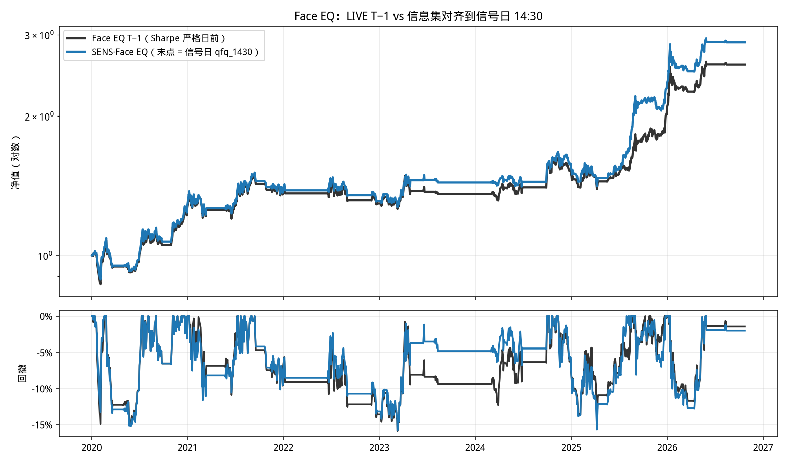
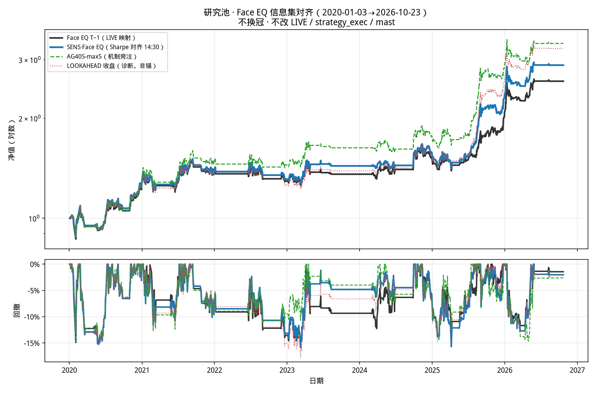

# 研究池 · SENS·Face EQ 信息集对齐（不碰 LIVE）

日期：2026-11-02  
范围：仅研究池。**零改动** `strategy_exec` / `LIVE_OPS` / `champion_mast` / 实盘池 / 固收+ / 红利袖。斜率族已收口，本 PR 不开新刀。

## 定位

| 产物 | 在哪 | 数字 |
|---|---|---|
| Face EQ T−1（等权、fill-only） | PR#50 `SPIKE-S20-SIZE-EQ-HYST-M2M3-LIVE1430` | **158.3% / −15.9% / C0.94** |
| 引擎口径 | 同 PR `run.py` · `sharpe_n_on` | 窗**严格日前**（LIVE 映射） |
| AG40S-max5 旁注 | PR#106 `research/accel-gate/out` | **235.6% / −14.8% / C1.32**（记正、不换冠） |
| `data_v1016` | **不在本仓库**；MF 脚本写死 `/workspace/etf-momentum/data_v1016/` | Face EQ **不用**它；用 `CLOUD-BATCH-2026-10-26/research_cache` |
| 派活点名 SENS·Face EQ ≈230.4%/−15.4%/C1.24 | 全部分支无此行 | **本 kit 未复现** → 【待核实】，不钉锚 |

`main` 几乎是空壳。上述研究都在未合并 PR 分支。本 PR 只新增 `research/sens-face-eq/`。

## 信息集：LIVE T−1 vs 对齐到信号日 14:30

分类 / 14:30 价 / `cache_1430_snaps` 本来就是信号日 14:30。  
**真正的 T−1 在填席键 SHARPE20**：

```text
LIVE / T−1     sharpe_n_on(closes, d, 20)     窗 = 日收益，截止 d 的前一交易日
SENS1430       同一函数，include_asof=True    末点改写为该日 qfq_1430（不是周五收盘）
LOOKAHEAD      include_asof=True + 周五收盘    诊断；14:30 之后才看得到，不能当锚
```

LIVE `sharpe_n_on` / `_sharpe20` 仍是 `index < asof`。研究锚 ≠ 自动改 LIVE。

## 主表（2020-01-03→2026-10-23，n=349 周；TV25、0.2%RT、L≤1）

| 账本 | 角色 | ret | maxDD | Calmar | 2020–22 | 2023–26 |
|---|---|---:|---:|---:|---|---|
| Face EQ T−1 | LIVE 映射 / 研究基线 | **158.3%** | **−15.9%** | **0.94** | 29.3%/−14.9%/0.60 | 99.8%/−14.3%/1.39 |
| SENS·Face EQ | **可复现研究锚** | **188.7%** | **−15.8%** | **1.07** | 31.0%/−15.2%/0.62 | 120.4%/−15.7%/1.47 |
| LOOKAHEAD 收盘 | 诊断 · 非锚 | 224.0% | −17.7% | 1.07 | 26.1%/−15.7%/0.51 | 157.0%/−14.7%/1.92 |
| AG40S-max5 | 机制旁注 · 不升格 | 235.6% | −14.8% | 1.32 | 44.6%/−14.8%/0.89 | 132.1%/−14.7%/1.69 |
| 派活 230.4/15.4/1.24 | 【待核实】 | — | — | — | — | 本 kit 无此行 |

出处：T−1 = PR#50 `summary.json`，本跑逐 bit 贴上（终值 NAV 2.58285）。  
SENS / LOOKAHEAD = 本 PR 对同一 kit 只改 Sharpe 截止。  
AG40S = PR#106 `out/table.csv`（F0 锚 131.6%/−18.8%/0.70，非 Face EQ 尺）。

持仓：T−1 vs SENS 差异周 122/198，Jaccard 0.65。空仓周都是 150。大头在后段 2025（SENS +51.6% vs T−1 +38.9%）。

## 图





## 为什么不是 230.4%，以及为什么不能升 LIVE

1. **可复现的信息集对齐（14:30）只把 Face EQ 从 158.3% 抬到 188.7%**（Δret +30.4pp，MDD 几乎不深，Calmar 0.94→1.07）。这是「大头在信息集」的可引用幅度。
2. 把 Sharpe 末点换成**周五收盘**才到 224.0%，但 MDD 加深到 −17.7%，Calmar 并不更好。这是前视，不是 14:30 信息集。
3. 派活三元组 230.4%/−15.4%/C1.24 与 1、2 都贴不上，也不是 AG40S。**不把它写成研究冠军钉。**
4. AG40S 相对 **SENS 188.7%** 不是薄边际（+47pp / Calmar +0.25），相对派活 230.4 才像薄边际。按已拍板：AG40S 仍是斜率族机制旁注，**不升格**；斜率族已收口。
5. LIVE 填席仍是 S20-max5、Sharpe **严格日前**。研究池 Face EQ ≠ 实盘冠军主钉（JUDGING_LOG 对照基线 ≈135%/−18.3%/C0.74）。**禁止**因为研究锚纠偏去改 LIVE / mast。

## 复现

```bash
# 1) 只要核图表与钉住的 T−1
python3 research/sens-face-eq/verify_numbers.py
python3 research/sens-face-eq/plot_equity.py

# 2) 从 PR#50 kit 重跑三本（需 FACE_EQ_KIT / FACE_EQ_RUN）
git archive origin/cursor/spike-s20-size-eq-hyst-m2m3-live1430-4a23 \
  research/SPIKE-S20-SIZE-EQ-HYST-M2M3-LIVE1430 \
  research/cloud_batch/CLOUD-BATCH-2026-10-26 | tar -x -C /tmp/face-eq-kit
FACE_EQ_RUN=/tmp/face-eq-kit/research/SPIKE-S20-SIZE-EQ-HYST-M2M3-LIVE1430/run.py \
FACE_EQ_KIT=/tmp/face-eq-kit/research/cloud_batch/CLOUD-BATCH-2026-10-26 \
  python3 research/sens-face-eq/rebuild_from_kit.py
```

本目录不打包 72MB `research_cache`。AG40S 曲线取自 PR#106 `out/equity.csv` 切片，不重跑加速度闸。
